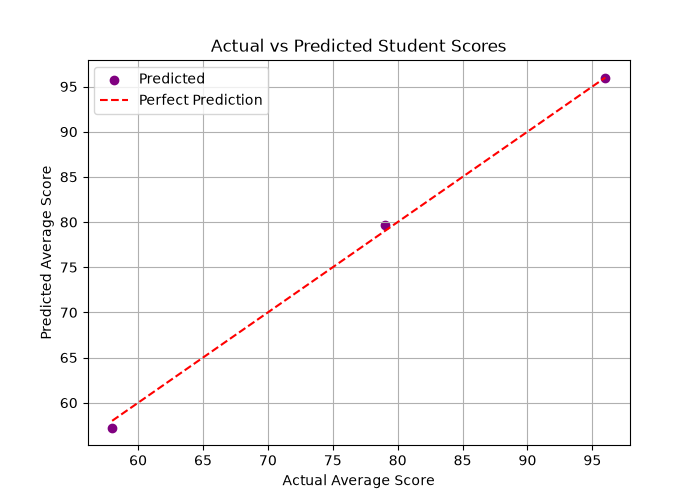

# Overview
This project predicts a students Average Score using Machine Learning.
It uses Study Hours, Attendance, and Previous Score to predict the final Average Score.

# Files in this Folder
"data_preprocessing.py" - Cleans the data
"linear_regression_model.py" - Trains and tests the model
"student_prediction.py" - Main complete project
"student_data.csv" - Original dataset
"actual_vs_predicted.png" - Graph of results

# 1. What I Learned About Data Preprocessing
Data preprocessing means making the data clean before using it for Machine Learning.
I learned how to check for missing values using isnull().sum().
I learned how to remove missing values using dropna() and remove duplicate rows using drop_duplicates().
I learned that if data is not clean, the model will give wrong predictions.
Clean data helps the model to learn correctly and give better results.

# 2. Why Train-Test Splitting is Important
Train Test splitting means dividing the data into two parts: one for training and one for testing.
I used 80% data for training and 20% data for testing.
It is important because if we test the model on the same data it learned from, it will look perfect but it will fail on new data.
Testing on new unseen data shows the real performance of the model.
It helps us to check if the model is really learning or just remembering.

# 3. Evaluation Metrics I Used
MAE (Mean Absolute Error): Average difference between actual and predicted scores. Lower is better.
MSE (Mean Squared Error): Average of squared errors. It punishes big mistakes more.
RMSE (Root Mean Squared Error): Square root of MSE. It is in same unit as scores, so easy to understand.
R2 Score: Shows how much of the data the model can explain. 1.0 means perfect, 0 means no learning.

# 4. My Model's Performance and Observations
 My model got a good R2 Score of around 0.81, which means it can explain 81% of the data.
 MAE was around 5.00, which means on average my prediction was only 5 marks away from the real score.
 I observed that students with more Study Hours and higher Attendance got higher scores.
 Previous Score was the most important feature for prediction.
 The scatter plot shows most points are close to the red line, which means predictions are close to real values.
 The model works well, but with more data it can become even better.

# Visualization
