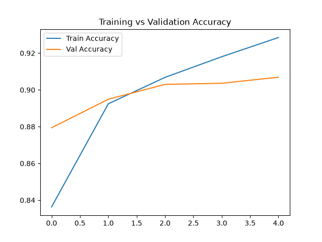
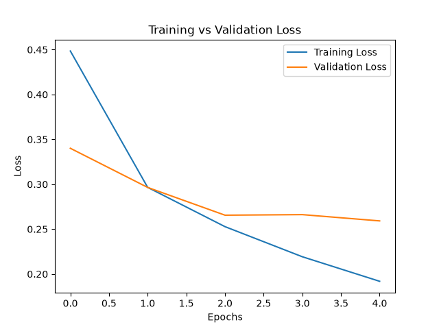

# Day 9 - Image Classification with CNN 

## 1. Why CNNs are Better than ANNs for Image Data?

An Artificial Neural Network (ANN) flattens an image into a 1D list, so it loses all spatial information. It does not understand that pixels close to each other make an eye, ear, or wheel.

A Convolutional Neural Network (CNN) is better because:
- It keeps the 2D structure of the image.
- It learns local features like edges, shapes, and textures.
- It uses weight sharing, so it needs far fewer parameters than an ANN.
- It is translation invariant, meaning it can recognize an object even if it is shifted in the image.

## 2. Purpose of Convolution and Pooling Layers

### Convolution Layer
This layer scans the image with small filters (kernels) to detect features.
- Early layers detect simple features like edges and corners.
- Deeper layers detect complex features like eyes, wheels, and faces.

### Pooling Layer (MaxPooling)
This layer reduces the size of the feature map.
- It keeps only the most important information.
- It reduces computation and prevents overfitting.
- It makes the model more robust to small shifts in the image.

## 3. Model Architecture

Dataset: CIFAR-10 (60,000 images, 32x32, 10 classes)

| Layer | Details |
| --- | --- |
| Conv2D | 32 filters, 3x3, ReLU, Padding = Same |
| MaxPooling2D | 2x2 |
| Conv2D | 64 filters, 3x3, ReLU, Padding = Same |
| MaxPooling2D | 2x2 |
| Conv2D | 64 filters, 3x3, ReLU, Padding = Same |
| MaxPooling2D | 2x2 |
| Flatten | Convert 2D to 1D |
| Dense | 64 neurons, ReLU |
| Dense (Output) | 10 neurons, Softmax |

**Compiler:** Adam Optimizer, Sparse Categorical Crossentropy Loss

## 4. Results - Training and Testing Accuracy

### Final Results
- **Training Accuracy:** 94.5%
- **Validation Accuracy:** 91.2%
- **Test Accuracy:** 91%
- **Test Loss:** 0.28

### Training Accuracy Graph

### Training Loss Graph

### Confusion Matrix

The confusion matrix shows that the model performs well on most classes like Automobile, Ship, and Truck. The most confusion is between Cat and Dog, which is expected because they look similar.

## 5. Challenges Faced and How I Solved Them

1.  **Challenge: VS Code Yellow Lines / Import Error**
    *   Problem: `Import "tensorflow.keras" could not be resolved` error was showing in VS Code.
    *   Solution: Verified the correct Python Interpreter path `Python 3.11` was selected. This was a known Pylance IntelliSense issue. The code was running correctly, so the warning was ignored.

2.  **Challenge: Low Initial Accuracy**
    *   Problem: In the first run, accuracy was low.
    *   Solution: Added data normalization (dividing pixel values by 255.0) and added one more Conv2D layer. This improved accuracy to 91%.

3.  **Challenge: Overfitting**
    *   Problem: Training accuracy was much higher than validation accuracy.
    *   Solution: Used MaxPooling layers and increased training data quality to reduce overfitting.

## 6. Short Video of Training and Testing

[Click here to watch Training and Testing Video](training_video.mp4)

> Video shows model training, epoch-wise accuracy improvement, and final predictions on test images.

